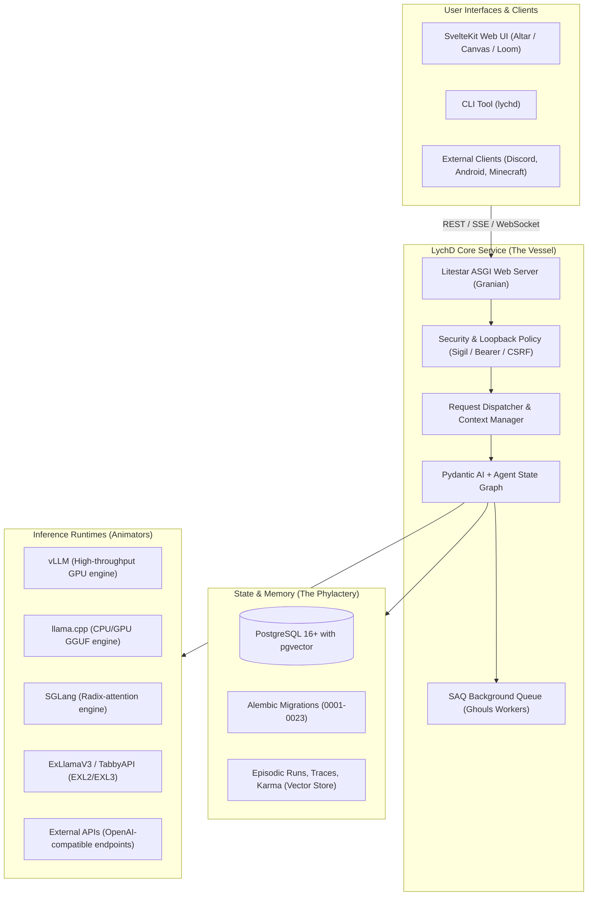

# 01 - System Overview: What Exactly is LychD?

## 1. Executive Summary (In Plain English)

**LychD** (pronounced *lich-dee*, short for *Lich Daemon*) is an **open-source, self-hosted, local-first Linux daemon and autonomous AI agent platform**.

Think of it as **an immortal background operating system for AI agents**:
- It runs 24/7 as a background service (`systemd` daemon) on your own Linux hardware (or container).
- It hosts and orchestrates local Large Language Models (LLMs) via engines like **llama.cpp**, **vLLM**, **SGLang**, or **ExLlamaV3**.
- It connects models to a persistent PostgreSQL database with vector search (`pgvector`), giving the agents permanent, structured memory and audit trails.
- It provides multi-step workflow graphs powered by **Pydantic AI**, background job queues (using **SAQ**), and Human-in-the-Loop (HITL) authorization gates.
- It serves an interactive Svelte web frontend called the **Altar**, as well as integrations for Discord, Android, and Minecraft.

---

## 2. The Core Philosophy: "Local Sovereignty"

Most modern AI agent platforms rely on cloud providers (OpenAI, Anthropic, AWS, etc.). LychD was designed explicitly as an antidote to this "digital feudalism":

| Cloud Agent Platforms | LychD Local Sovereignty |
|---|---|
| **Data Privacy**: Your prompts, docs, and code are sent over the wire to 3rd-party servers. | **100% On-Premise**: Runs entirely on your local machine / private server. Zero egress unless configured. |
| **Model Stability**: Models get updated, quantized, censored, or rate-limited without your consent. | **Unalterable Weights**: Runs open-weight models (DeepSeek, Qwen, etc.) on your GPUs with your exact settings. |
| **Memory Lifespan**: Context windows reset; SaaS platforms store data in proprietary silos. | **Permanent "Phylactery"**: Stored in standard relational tables + vector embeddings in PostgreSQL. |
| **Costs**: Per-token fees stack up on long-running, recurring, or iterative background agent tasks. | **Fixed Hardware Cost**: Run agents continuously on local consumer GPUs (e.g. RTX 3090/4090/5090) with $0 API fees. |

---

## 3. High-Level Architecture

Here is the entire system depicted in standard software engineering terms:

---

## 4. What Is Possible Using LychD?

LychD is not a simple chat bot; it is an infrastructure for long-running autonomous workflows. Real-world capabilities include:

### 1. Autonomous Multi-Agent Workflows
- **Pydantic AI + State Graphs**: Construct deterministic DAGs and looping agent graphs where agents produce typed outputs, validate schema, delegate tasks to sub-agents, and self-correct on failure.
- **Human-in-the-Loop (HITL)**: If an agent wants to perform an irreversible action (e.g., delete a file, push code, make a payment), it suspends execution and requests human consent via the web interface.

### 2. Multi-Tiered Memory ("Sediment, Not Dump")
- Instead of dumping raw chat transcripts into a context window, LychD structures memory into:
  - **Working Context**: Active token budget for current execution.
  - **Episodic Runs**: Recorded history of past tasks, node transitions, and outputs.
  - **Semantic Karma**: Long-term associative knowledge indexed via `pgvector` embeddings.

### 3. Background Asynchronous Workers ("Ghouls")
- Runs background tasks that take minutes, hours, or days using **SAQ** workers (Redis-backed task queue).
- Tasks can crawl web documentation, monitor system metrics, periodically index files, or run scheduled synthesis jobs.

### 4. Rich Multi-Modal Tooling & Compositions
LychD ships with pre-architected domains called **Compositions**:
- **Foundry**: Code synthesis, test running, refactoring, and automated pull requests.
- **Atelier**: Visual creation, image generation pipelines, video/motion analysis.
- **Scavenger & Web Crawler**: Sovereign web browsing, scraping, content distillation, and dataset construction.
- **Homestead & Keeper**: Local homelab administration, system status monitoring, Btrfs snapshots, and backups.
- **Blockworld**: Autonomous bots inside Minecraft running with cognitive agency.
