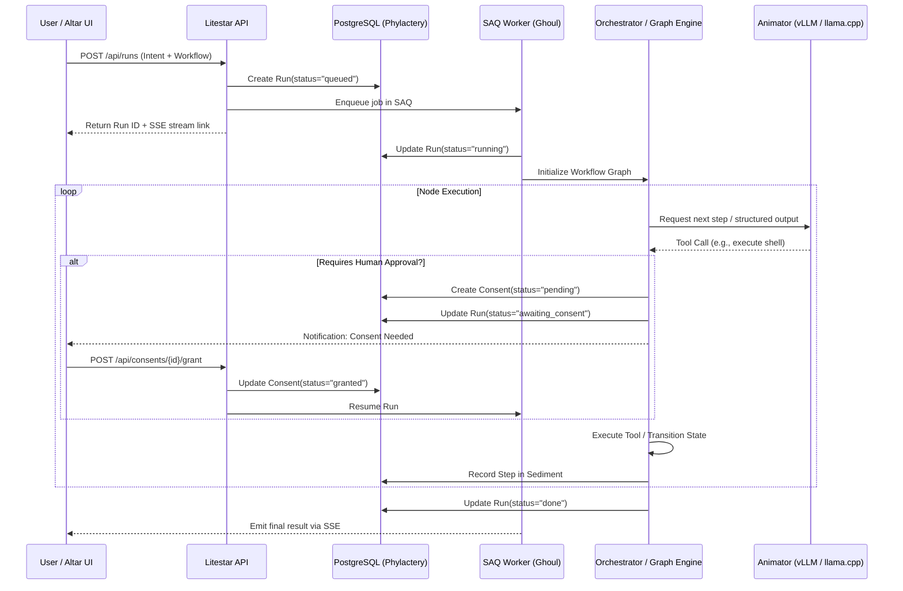

# 05 - Agent Execution & Graph Orchestration

LychD does not run agents as simple reactive prompt loops. Instead, it uses **Pydantic AI** and a deterministic **State Graph Engine** to coordinate complex multi-step reasoning, tool invocations, sub-agent delegation, and human authorization checkpoints.

This document breaks down how agent tasks execute, how graphs are structured, and how background workers ("Ghouls") operate.

---

## 1. Architectural Foundations

1. **Pydantic AI**:
   - Every agent input, output, and tool call is governed by strict Pydantic models.
   - Enforces type safety, JSON schema validation, and structured tool signatures for LLMs.
2. **State Graphs (ADR 24)**:
   - Workflows are defined as Directed Acyclic Graphs (DAGs) or cyclic state machines with typed node transitions.
   - Nodes can be:
     - LLM cognition nodes (evaluating input, generating plans)
     - Tool execution nodes (running shell commands, database queries, file edits)
     - Human-in-the-Loop gates (`awaiting_consent`)
     - Sub-agent delegation nodes (`AgentJob`)
3. **Task Queue ("Ghouls")**:
   - Powered by **SAQ** (Simple Async Queue) in `src/lychd/ghouls/runs.py`.
   - Long-running workflows run out-of-process so the ASGI server remains responsive.

---

## 2. The Execution Lifecycle of a Run

---

## 3. Human-in-the-Loop (HITL) Consent Gates

One of LychD's most critical safety features (defined in **ADR 25**) is that agents **cannot perform high-consequence actions without explicit human approval**.

When an agent attempts an action that crosses a defined boundary:
1. The orchestrator suspends the graph at the current step.
2. It transitions the `Run` state to `awaiting_consent`.
3. It creates a `Consent` record detailing:
   - Exactly what command or mutation is proposed.
   - The reasoning provided by the agent.
   - The risk tier.
4. The user inspects the request on the Altar web UI or via the CLI (`lychd consent approve <id>`).
5. Only once approval is recorded in PostgreSQL does the SAQ worker resume the graph node.

---

## 4. Multi-Agent Delegation (`src/lychd/domain/delegation/`)

LychD supports hierarchically nested agents:
- **Parent Orchestrator**: High-level planner that breaks a big goal into subtasks.
- **Sub-Agents (`AgentJob`)**: Specialized workers (e.g. Code Reviewer, Web Researcher, Test Runner).
- Sub-agents run with isolated context windows to prevent token bloat. Their output is validated against a Pydantic schema before being returned to the parent graph.

---

## 5. Background Ghouls Worker Engine (`src/lychd/ghouls/runs.py`)

The file `src/lychd/ghouls/runs.py` (~78 KB) is one of the most critical execution files in the repository:
- It defines the async worker loop that dequeues runs.
- It handles crash resilience: if a worker process dies mid-task, the database preserves the exact last completed `Step`, allowing safe retry or resumption.
- It manages concurrency limits so you don't overwhelm your local GPU with too many parallel inference requests.
