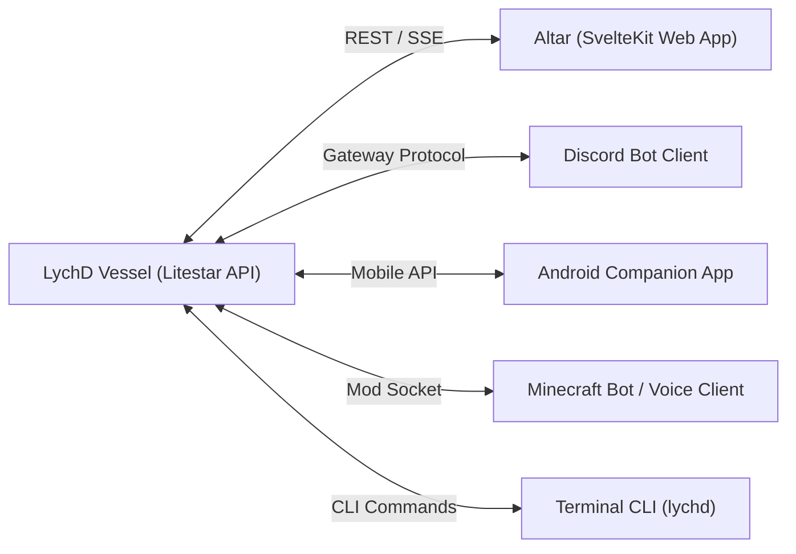

# 07 - Frontend & UI: The Altar & Client Ecosystem

In LychD, the **Altar** is the sacred threshold where the human operator ("The Magus") interacts with the running Lich daemon. In engineering terms, it is a high-performance **SvelteKit web application** communicating with the Litestar backend over **REST**, **WebSockets**, and **Server-Sent Events (SSE)**.

Additionally, LychD ships with external client adapters for other ecosystems (Discord, Android, Minecraft).

---

## 1. The Web UI: The Altar (`clients/web/`)

- **Framework**: Svelte 5 / SvelteKit + Vite + TypeScript.
- **Styling**: Native CSS tokens (`app.css`, ~62 KB), adhering to dark mode aesthetics, glassmorphic HUDs, and low-latency interaction.
- **API Synchronization**: Auto-generated TypeScript types synced directly from the backend's `openapi.json` (~307 KB).

### Major Altar Surfaces (`clients/web/src/lib/`):
1. **Bridge (`bridge/`)**:
   - The primary conversational and interactive terminal dock.
   - Streams live LLM tokens and tool calls via Server-Sent Events (SSE).
   - Renders interactive Human-in-the-Loop (HITL) consent dialogs inline.
2. **Canvas (`canvas/`) & Atlas (`atlas/`)**:
   - Project and workspace visualization.
   - Atlas serves as a master visual catalogue of multi-agent tasks, files, and project structures.
3. **Graph (`graph/`) & Loom**:
   - Interactive visual DAG inspector showing active Pydantic AI state graph nodes.
   - Watch agents traverse from decision node to tool node in real time.
4. **Orb (`orb/`)**:
   - Real-time diagnostic HUD: shows GPU VRAM utilization, systemd service health, active background Ghouls, and PostgreSQL pool stats.
5. **Creation & Archive (`creation/`, `archive/`)**:
   - Artifact viewer for inspecting generated documents, code changes (diff views), and media deliverables.

---

## 2. Multi-Client Architecture

LychD is designed with a headless backend, allowing the daemon to be controlled across multiple client interfaces simultaneously:

### Supported Client Adaptors (`clients/`):

1. **Web (`clients/web/`)**:
   - Default primary interface, served directly by Litestar or independently during development via Vite.
2. **Discord (`clients/discord/`)**:
   - Enables agents to live inside Discord servers as members.
   - Can answer questions, run autonomous research tasks via slash commands, and ping users when a long background job finishes.
3. **Android (`clients/android/`)**:
   - Native mobile management client to monitor daemon health and approve HITL consent requests on the go.
4. **Minecraft (`clients/minecraft/` & `clients/minecraft-voice/`)**:
   - Integrates the Lich into Minecraft via automated bots.
   - Supports in-game spatial perception, task coordination, and live voice conversation with players using real-time local text-to-speech.
