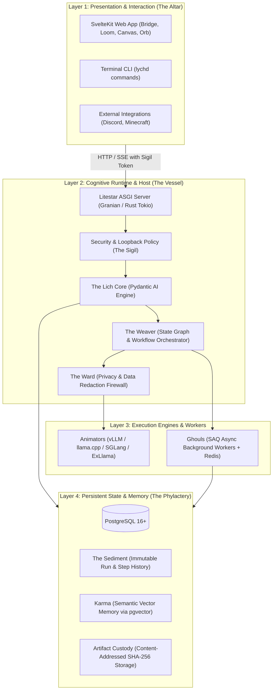

# Part 2: The Core Mental Model (How Everything Connects)

To work comfortably in LychD, think of it as an **autonomous operating system for local AI agents**, built around four decoupled layers:
1. **Presentation & Interaction** (The Altar & CLI)
2. **Cognitive Runtime & Host** (The Vessel & Lich Core)
3. **Execution Engines & Workers** (Animators & Ghouls)
4. **Persistent State & Memory** (The Phylactery)

---

## 1. Architectural Architecture Diagram

---

## 2. The Step-by-Step Flow of an Action

Understanding how an instruction travels through the system clarifies all lore abstractions:

1. **User Request**: The operator types a command or message in the SvelteKit **Altar** (or CLI).
2. **Authentication ("Sigil")**: Litestar validates the caller's cryptographic bearer token and applies local loopback network guards.
3. **Cognitive Ingestion ("Runes")**: The **Lich** receives the intent, validating it against structured Pydantic models (**Runes**) that enforce schema and token limits.
4. **Pipeline Orchestration ("Weaver" & "Scrolls")**:
   - The **Weaver** constructs or executes a workflow graph (**Scroll**).
   - If the task is simple, it executes directly. If it is long-running or requires heavy processing, it dispatches the job to the **Ghouls** (SAQ async worker queue).
5. **Model Inference ("Animators")**:
   - Prompts are routed to an **Animator** (e.g. local vLLM or llama.cpp **Soulstone**).
   - If external APIs (**Portals**) are used, the request first passes through the **Ward** to redact private secrets and PII.
6. **Safety Gate ("Consent")**:
   - If an agent generates an irreversible action (e.g., deleting a file, running a dangerous shell command), execution pauses at an `awaiting_consent` state until approved by a human at the Altar.
7. **Commitment to Memory ("Sediment" & "Karma")**:
   - Every single prompt, tool result, and intermediate node step is written to PostgreSQL as **Sediment**.
   - Key learnings, facts, and code summaries are converted into vector embeddings and saved into **Karma** for associative semantic recall across future tasks.
8. **UI Reflection**: The Altar streams output tokens and graph node states back to the browser via Server-Sent Events (SSE).

